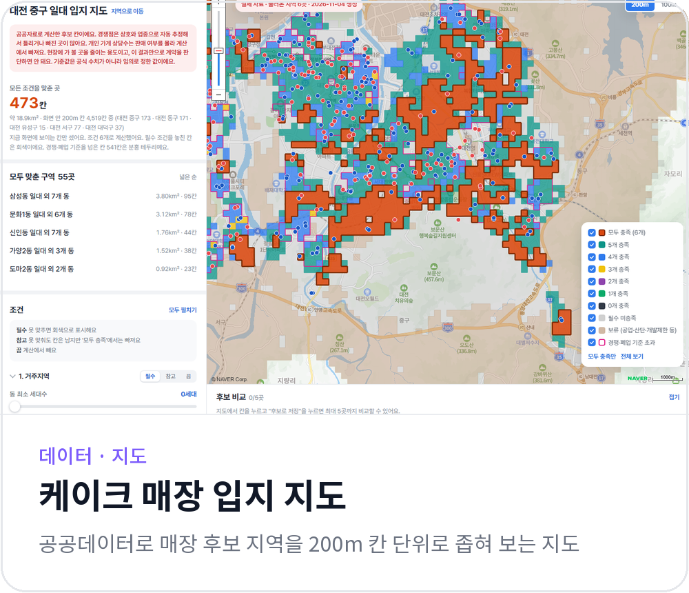
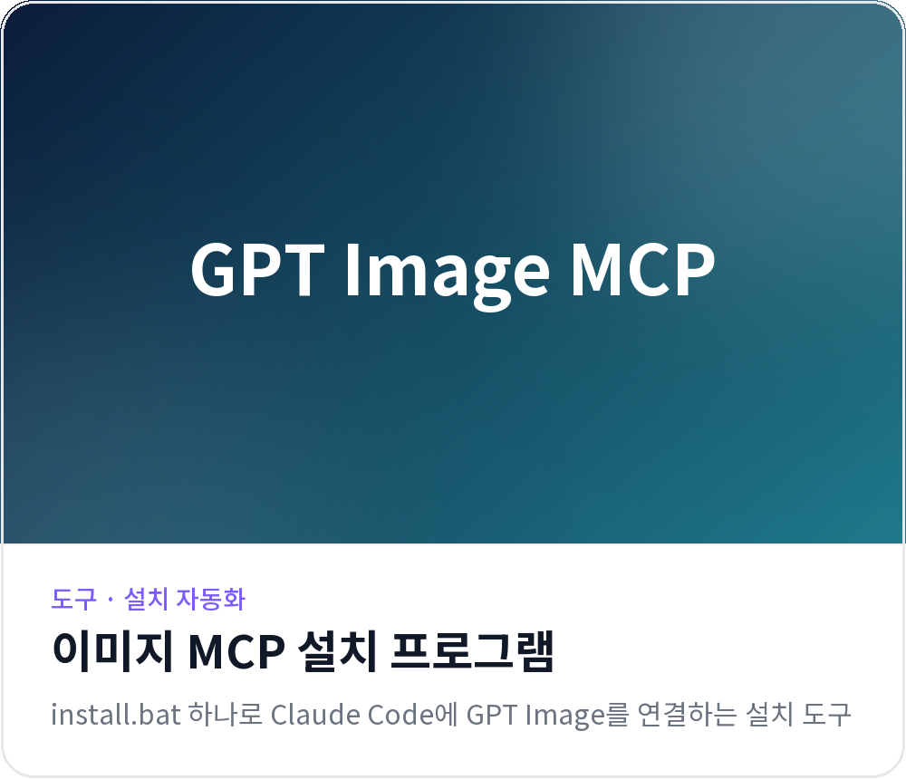
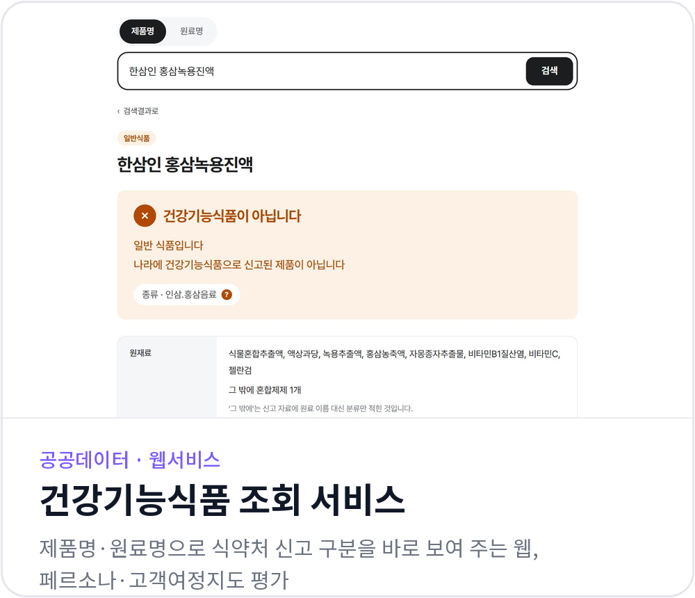

  

L.L.M Academy 대전 1기에서 작업한 프로젝트입니다. 폴더마다 프로젝트 하나이고, 카드를 누르면 해당 폴더로 이동합니다.

 

<!-- PROJECTS:START -->

  
  

  
  

  
  

  

<!-- PROJECTS:END -->

 

---

L.L.M Academy 대전 1기 원본 안내문

# L.L.M Academy - 대전 1기

본 Repository는 L.L.M Academy 대전 1기 수강생들의 프로젝트 수행을 위한 공간입니다.

## 📌 이용 방법
1. 본 Repository 우측 상단의 `Fork` 버튼을 클릭합니다.
2. 본인의 GitHub 계정을 Owner로 선택하여 Fork를 생성합니다.
3. Fork한 개인 Repository에서 프로젝트를 진행합니다.
4. 개인 및 팀별 폴더 구성은 자유롭게 진행합니다.

## 📌 팀 프로젝트
- 팀 프로젝트는 팀원 간 협의하여 공동 작업 공간을 구성합니다.
- 필요한 경우 팀원을 Collaborator로 초대하여 함께 작업할 수 있습니다.

## ⚠️ 유의사항
- 본 Repository 및 Fork한 Repository는 Public으로 외부에 공개됩니다.
- 개인정보, 비밀번호, API Key 등 민감한 정보는 업로드하지 마세요.
- 프로젝트별 제출 및 평가 방식은 담당 강사의 안내를 따릅니다.

